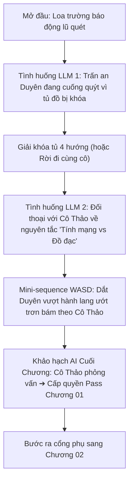
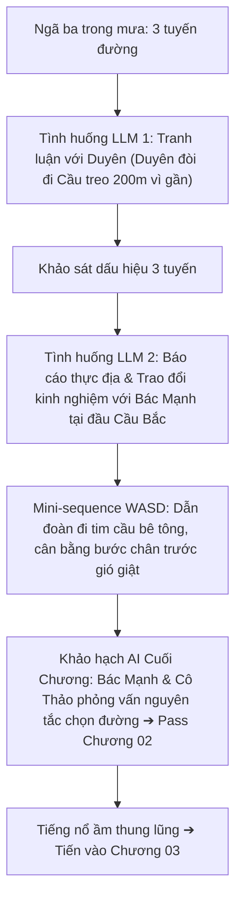
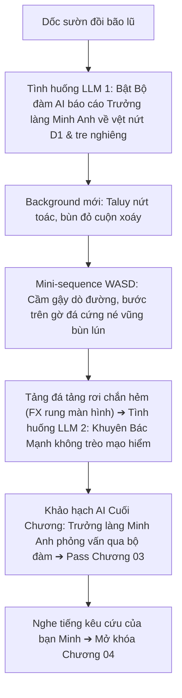
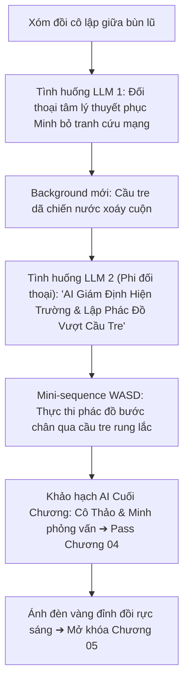
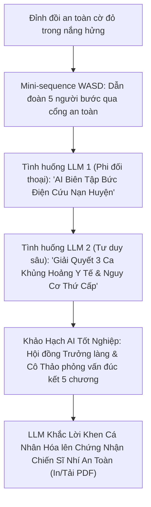

# Thiết Kế Nâng Cấp Toàn Diện 5 Chương: LLM Sáng Tạo, Giọng Lồng Tiếng, Đồ Họa Độc Bản & Di Chuyển WASD Ngữ Cảnh

> **Ngày lập:** 2026-10-25  
> **Nhánh thực hiện:** `feat/2D-chapter1to5`  
> **Trạng thái:** Bản thiết kế đã được người dùng duyệt tuần tự 5 chương  

---

## 1. Mục Tiêu & Nguyên Tắc Cốt Lõi

### 1.1. Mục Tiêu (Goals)
1. **Mở rộng tương tác LLM sáng tạo:** Mỗi chương có từ 2–3 tình huống áp dụng Google Gemini (`gemini-3.5-flash-lite`), đa dạng hóa hình thức (đàm thoại tâm lý, phân tích kết cấu kỹ thuật, biên tập bức điện cứu nạn khẩn cấp, xử lý khủng hoảng y tế sau bão).
2. **Khảo hạch AI cuối mỗi chương (Pass/Fail Gate):** Người chơi phải trả lời câu hỏi mở sát hạch của nhân vật đại diện (Cô Thảo, Bác Mạnh, Trưởng làng Minh Anh). LLM chấm điểm theo chuẩn sư phạm cứu hộ để cấp quyền `PASS CHƯƠNG` mở màn kế tiếp.
3. **Giọng lồng tiếng (Vietnamese Voice TTS):** Tích hợp Web Speech API đa sắc thái giọng điệu (Cô Thảo, Bác Mạnh, Trưởng làng Minh Anh, Bạn, Duyên, Minh).
4. **Đồ họa độc bản & Hiệu ứng động (Dynamic FX):** Sinh mới toàn bộ background cho Chương 3, 4, 5 (không tái sử dụng nền Ch1/Ch2), bổ sung hiệu ứng rung màn hình (screen shake), nước lũ cuộn xoáy, bọt khí sủi tăm, vết nứt thở.
5. **Di chuyển tự do WASD có ngữ cảnh (Situational WASD):** Không ép buộc 100% thời lượng, chỉ kích hoạt tại các phân đoạn vượt chướng ngại vật/địa hình cụ thể (hành lang trơn trượt, cầu bê tông gió giật, vũng bùn lún, cầu tre dã chiến, cổng trạm cứu hộ).

### 1.2. Nguyên Tắc Bất Di Bất Dịch (Non-Goals & Invariants)
- **Không đập đi xây lại:** Kế thừa toàn bộ kiến trúc 2D Canvas, hệ thống State, Route Graph, Save/Load độc lập hiện có.
- **Bảo lưu lựa chọn liên chương (Cross-chapter persistence):** Duyên có gấu hay không từ Chương 01 tiếp tục truyền xuyên suốt tới Chương 05.
- **Zero Regression:** 101 bài kiểm thử tự động hiện tại phải tiếp tục duy trì 100% Green.

---

## 2. Chi Tiết Nâng Cấp Từng Chương (Chương 01 ➜ Chương 05)

### 🏫 Chương 01: Lớp 4B Trong Mưa Lớn (`index.html`)



1. **Tình huống LLM 1 — Trấn an Duyên quên mật mã tủ đồ:**
   - *Bối cảnh:* Duyên chạy tới tủ nhưng khóc vì quên mật mã khóa 4 hướng, tiếc con gấu bông quà sinh nhật của bố.
   - *Cơ chế:* Người chơi gõ lời khuyên an ủi, gợi ý Duyên bình tĩnh nhớ lại manh mối sơ đồ trên tường hoặc khuyên Duyên ưu tiên tính mạng đi cùng cô. Duyên (Gemini) phản hồi cảm xúc chân thật, giảm hoảng loạn.
2. **Tình huống LLM 2 — Đối thoại với Cô Thảo về giới hạn an toàn:**
   - *Bối cảnh:* Cô Thảo vào lớp phát lệnh sơ tán.
   - *Cơ chế:* Người chơi/Duyên hỏi: *"Nếu chỉ nán lại 30 giây để lấy đồ rất quý giá thì có nên không?"*. Cô Thảo (Gemini) giải thích: Trong lũ quét, 30 giây là ranh giới sống chết, tính mạng là thứ duy nhất không thể làm lại được.
3. **Mini-sequence WASD (Hành lang trơn trượt):**
   - 15 giây điều khiển Bạn bước trên gờ thảm khô, né vũng nước trơn và chậu cây ngã để dẫn Duyên theo sát cô Thảo ra cổng phụ.
4. **Khảo hạch AI Cuối Chương 01:**
   - Cô Thảo hỏi mở: *"Khi có báo động sơ tán khẩn cấp, thái độ đúng đắn nhất đối với đồ đạc cá nhân để quên là gì và vì sao?"*
   - LLM chấm điểm theo tiêu chí: Tính mạng là số 1, không quay lại lấy đồ ➔ `PASS CHƯƠNG 01`.

---

### 🌉 Chương 02: Ba Con Đường (`chapter02.html`)



1. **Tình huống LLM 1 — Thuyết phục Duyên không đi tắt Cầu treo 200m:**
   - *Bối cảnh:* Duyên nhìn thấy mái nhà tập kết qua cầu treo 200m nên giục đi đường này thay vì đường Bắc 650m xa gấp 3 lần.
   - *Cơ chế:* Người chơi tự gõ lý lẽ phân tích: nước cuộn xoáy ngập mố, cây trôi va đập. Duyên (Gemini) hiểu ra *"gần nhất chưa chắc đã an toàn nhất"*.
2. **Tình huống LLM 2 — Báo cáo thực địa với Bác Mạnh dân phòng:**
   - *Bối cảnh:* Bác Mạnh đang rà soát an toàn cầu bê tông phía Bắc.
   - *Cơ chế:* Bác Mạnh hỏi tình hình quan sát từ ngã ba. Người chơi tự gõ các dấu hiệu (đá dăm lăn, nước rỉ đục). Bác Mạnh (Gemini) phân tích chuyên môn về nguy cơ taluy đứt gãy.
3. **Mini-sequence WASD (Qua Cầu Bắc trong gió giật):**
   - 20 giây điều khiển Bạn giữ bước chân đi giữa tim cầu bê tông, căn nhịp bước trước các đợt gió tạt ngang suối, che chắn cho Duyên.
4. **Khảo hạch AI Cuối Chương 02:**
   - Bác Mạnh hỏi: *"Tại ngã ba, vì sao cả đoàn lại chọn đi đường vòng phía Bắc 650m thay vì đường 450m hay 200m?"*
   - LLM chấm điểm nhận thức: Không chọn đường theo cự ly mù quáng, ưu tiên địa hình ổn định ➔ `PASS CHƯƠNG 02`.

---

### ⛰️ Chương 03: Vết Nứt Sườn Đồi (`chapter03.html`)



1. **Background mới 100% độc bản & FX:**
   - 4 cảnh sinh mới hoàn toàn: Dốc đá sườn vực (`ridge_entry`), Bờ taluy xé toạc vết nứt vòng cung ngậm nước (`crack_zone`), Khúc cua suối bùn đỏ ngập ngang bắp chân (`mudflow_bend`), Khối đá tảng hàng chục tấn chắn ngang hẻm núi (`boulder_pass`).
   - FX rung màn hình (Screen Shake) và tiếng đá va đập rầm rập khi đá rơi.
2. **Tình huống LLM 1 — Báo cáo khẩn qua Bộ đàm AI cho Trưởng làng Minh Anh:**
   - Người chơi gõ báo cáo vệt nứt sườn dốc và bụi tre bật rễ. Trưởng làng (Gemini) cảnh báo sạt trượt taluy dương cấp 3, lệnh lùi xa mép vực 10m.
3. **Tình huống LLM 2 — Can ngăn Bác Mạnh không trèo qua đá tảng trơn:**
   - Bác Mạnh định trèo qua tảng đá trơn. Người chơi phân tích rủi ro đá chưa ổn định và sỏi dăm bên trên. Bác Mạnh (Gemini) đồng ý men theo sống đá gốc.
4. **Mini-sequence WASD (Vượt khúc cua tràn bùn):**
   - 20 giây điều khiển Bạn cầm cành cây dò đường, bước trên các gờ đá xám nổi, né vũng xoáy bùn lún ngập gối.
5. **Khảo hạch AI Cuối Chương 03:**
   - Trưởng làng Minh Anh hỏi qua bộ đàm: 3 dấu hiệu nhận biết sạt lở cấp tính và nguyên tắc xử lý khi gặp vật cản lớn ➔ `PASS CHƯƠNG 03`.

---

### 🤝 Chương 04: Chia Cắt & Cứu Bạn Học (`chapter04.html`)



1. **Background mới 100% độc bản & FX:**
   - 4 cảnh sinh mới hoàn toàn: Xóm đồi ngập lụt (`village_outskirts`), Lán gỗ tạm nơi Minh co ro trên bàn (`isolation_post`), Cầu tre dã chiến bắc qua dòng suối lũ đỏ cuộn xoáy hung hãn (`bamboo_bridge`), Dốc đá tảng cổ kính rêu phong thoát ngập (`safe_ascent`).
   - FX nước lũ cuộn xoáy và cầu tre đu đưa nhẹ.
2. **Tình huống LLM 1 — Thuyết phục Minh bỏ tranh để giữ tính mạng:**
   - Đối thoại tâm lý sâu sắc: Minh nức nở tiếc tranh 8/3 của mẹ. Người chơi khuyên giải: Mẹ chỉ cần Minh an toàn trở về. Minh (Gemini) gạt nước mắt, nhận ra tính mạng là vô giá và trèo xuống bàn gia nhập đoàn.
3. **Tình huống LLM 2 (Phi đối thoại) — AI Giám định hiện trường & Lập phác đồ vượt cầu tre (Tactical Blueprint):**
   - Người chơi kiểm tra 3 vị trí trên cầu tre: Mối buộc lạt tre, Thân tre đực mặt cầu, Cọc chịu lực dưới suối xoáy.
   - LLM Gemini đóng vai trò **Bộ phân tích cơ học & thủy văn thời gian thực**: đọc 3 thông số và xuất ra **Bản chỉ dẫn tải trọng & Phác đồ bước chân** (Vùng 1 cự ly 3m; Vùng 2 bám mạn trái; Vùng 3 bước dứt khoát lên bờ đá).
4. **Mini-sequence WASD (Thực thi phác đồ qua Cầu Tre):**
   - 25 giây điều khiển Bạn đi bọc lót ngay sau Minh, giữ thăng bằng nhịp bước theo phác đồ AI, đưa Minh qua cầu an toàn.
5. **Khảo hạch AI Cuối Chương 04:**
   - Cô Thảo & Minh hỏi mở: Thứ tự ưu tiên tính mạng và quy tắc qua cầu dã chiến trong lũ ➔ `PASS CHƯƠNG 04`.

---

### 🏛️ Chương 05: Đỉnh Đồi An Toàn & Tổng Kết Hành Trình (`chapter05.html`)



1. **Background mới 100% độc bản & FX:**
   - 3 cảnh sinh mới hoàn toàn: Cổng trạm cứu hộ cờ Tổ quốc phấp phới trong nắng rạng (`summit_gate`), Phòng họp chỉ huy bàn bản đồ địa hình và trà gừng (`command_post`), Gian hội trường gỗ ấm áp bếp lửa hồng quây quần (`safe_hall`).
   - FX vệt nắng hửng rạng (God rays) và bếp lửa reo tí tách.
2. **Tình huống LLM 1 (Phi đối thoại) — AI Biên tập bức điện cứu nạn gửi Huyện:**
   - Người chơi đánh dấu 3 điểm hiểm họa trên bản đồ. LLM Gemini biên dịch thành **Bức Điện Khẩn Cấp chuẩn quân báo cứu nạn** để Trưởng làng Minh Anh ký duyệt phát đi.
3. **Tình huống LLM 2 (Tư duy y tế sâu sắc) — Giải quyết 3 ca khủng hoảng sau bão:**
   - Người chơi giải quyết 3 ca khẩn cấp: (1) Bạn Minh hạ thân nhiệt tím tái (ủ ấm trung tâm, cấm hơ lửa trực tiếp); (2) Bác Mạnh rách bắp chân dính bùn đất (rửa sạch, sát trùng, cấm đắp lá bừa bãi); (3) Nguy cơ ngạt khí độc $CO$ do đốt than tổ ong trong phòng kín (mở thông gió, chuyển than ra ngoài).
   - LLM Gemini đóng vai **Chuyên gia Cứu Thương Chữ Thập Đỏ** phản biện tính khoa học và an toàn.
4. **Mini-sequence WASD (Tiến vào cổng an toàn):**
   - 15 giây điều khiển Bạn dẫn đầu đoàn 5 người bước qua cổng trạm trong tiếng vỗ tay của dân phòng.
5. **Khảo hạch AI Tốt Nghiệp & Chứng Nhận Cá Nhân Hóa:**
   - Hội đồng Trưởng làng & Cô Thảo phỏng vấn đúc kết 3 nguyên tắc sinh tử của toàn bộ 5 chương.
   - LLM chấm điểm theo Khung Năng Lực Sinh Tồn và **tự động khắc lời khen cá nhân hóa độc bản** lên Chứng Nhận Chiến Sĩ Nhí An Toàn (hỗ trợ in hoặc lưu PDF).

---

## 3. Kiến Trúc Kỹ Thuật & Module Tích Hợp

### 3.1. Voice TTS Module (`web/js/voice-tts.js`)
- Tích hợp `VietnameseSpeechEngine` với bộ cấu hình pitch/rate phân vai:
  ```javascript
  const VOICE_PROFILES = {
    thao: { pitch: 1.15, rate: 0.90, gender: 'female' },
    manh: { pitch: 0.80, rate: 0.95, gender: 'male' },
    minh_anh: { pitch: 0.85, rate: 0.88, gender: 'male' },
    minh: { pitch: 1.25, rate: 0.95, gender: 'child' },
    duyen: { pitch: 1.30, rate: 0.95, gender: 'child' },
    ban: { pitch: 1.20, rate: 1.00, gender: 'child' }
  };
  ```

### 3.2. AI Evaluator Router (`server/debrief-ai-handler.js`)
- Router backend xử lý các bài khảo hạch cuối chương và phân tích kỹ thuật:
  - `POST /api/debrief/evaluate` (Khảo hạch pass chương)
  - `POST /api/tactical/bridge-blueprint` (Phác đồ vượt cầu tre)
  - `POST /api/tactical/incident-dispatch` (Bức điện cứu hộ gửi Huyện)
  - `POST /api/medical/triage-solver` (Cố vấn y tế 3 ca khủng hoảng)

### 3.3. Situational WASD Controller (`web/js/situational-wasd.js`)
- Module quản lý vùng di chuyển 2.5D cục bộ cho các phân đoạn hành động:
  - Nhận diện va chạm vật cản (hazard colliders).
  - Thanh tiến trình vượt chướng ngại vật (progress bar).
  - Tự động hoàn trả quyền điều khiển về engine point-and-click khi kết thúc mini-sequence.

---

## 4. Kế Hoạch Kiểm Thử & Tiêu Chí Nghiệm Thu (Quality Gate)
- **Kiểm thử tự động:** Mở rộng bộ test lên $\ge 120$ tests, kiểm tra từng tình huống LLM, router API, module TTS và khảo hạch pass chương.
- **Tiêu chí nghiệm thu:**
  - Không có độ trễ treo đơ: Các gọi API Gemini đều có timeout 3500ms và fallback an toàn.
  - Mỗi chương đều có giọng đọc tiếng Việt rõ ràng.
  - Background Chương 3, 4, 5 hoàn toàn mới mẻ, mang phong cách chân thực và kịch tính.
  - Người chơi phải thực sự vượt qua khảo hạch AI mới có thể tiến sang chương tiếp theo.
